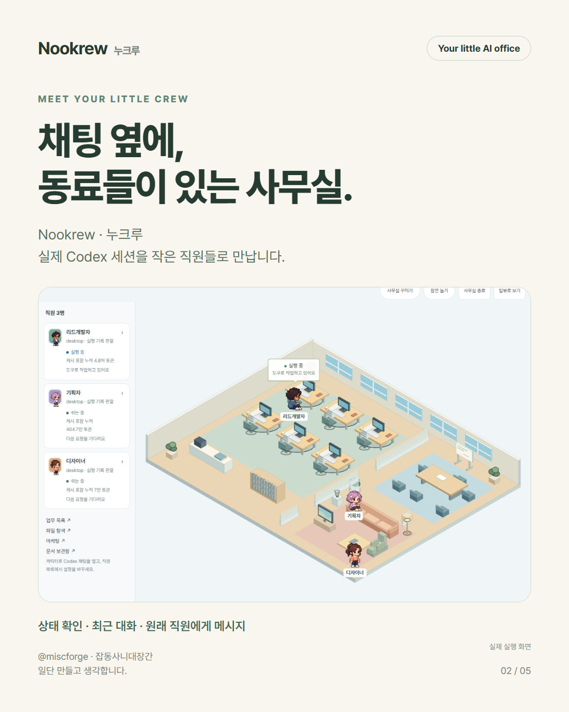

# Nookrew · 누크루

AI에게 일을 맡겼는데, 기다리는 건 나였습니다. 채팅창만 보고 기다리는 시간이 심심하고, 세션이 늘어나니 누가 끝났는지도 헷갈려서 작은 사무실을 만들었습니다.

**Your little AI office.** by **miscforge · 잡동사니대장간** — 일단 만들고 생각합니다.



## 설치 · Windows 무료 베타

**Codex에 아래 문장만 보내세요.** Windows의 로컬 실행이 가능한 Codex 대화에서 사용합니다.

```text
https://github.com/hw01931/nookrew
이 저장소의 Nookrew 플러그인을 사용자 공용으로 설치하고, 지금 작업 폴더의 사무실을 열어줘. README의 공식 Codex 설치 명령을 사용하고 프로젝트마다 다시 설치하지 마.
```

Codex가 저장소 안내를 읽고 아래 두 공식 명령으로 설치할 수 있습니다. 설치 후 Nookrew를 선택해 `시작` 또는 `start`라고 입력하면 됩니다. 호스트가 설치·실행 승인을 요청하면 확인하세요. 안내를 읽은 것과 실행 성공은 다르므로 반환된 설치 결과와 사무실 URL을 확인합니다.

직접 설치할 때의 공식 CLI:

```powershell
codex plugin marketplace add https://github.com/hw01931/nookrew.git
codex plugin add moyo-office@miscforge
```

플러그인 선택에서 **Nookrew**를 고른 뒤 **시작** 또는 **start**라고 입력하세요. 한 번 설치하면 다른 로컬 작업 폴더에서도 사용합니다. 최초 실행 권한 검토는 호스트 정책을 따릅니다. 일반 텍스트 멘션과 실제 플러그인 선택은 다를 수 있습니다.

프로젝트 등록은 필수가 아닙니다. 로컬 작업 폴더와 실행 도구는 필요합니다. ChatGPT 웹이나 로컬 실행이 없는 일반 대화에서는 시작할 수 없습니다. 현재 Windows x64용이며 Codex와 기존 ChatGPT 로그인을 사용합니다. 별도 Node/npm 설치는 필요하지 않습니다.

## 하는 일

- 실제 Codex 세션의 관찰 상태, 최근 대화, 원래 직원에게 메시지 접수
- 프로젝트 문서·파일·변경 확인, 문서 편집과 코멘트
- 가구 배치·테마·사용자 에셋, 혼자/쉬는 캐릭터와 로컬 미니게임

게임은 실제 직원 모델을 호출하지 않습니다. 접수·응답 종료·검증 완료는 별개입니다. 승인·중단은 원래 Codex에서 처리합니다. 캐시 포함 누적 토큰은 생성한 글의 양이나 청구액이 아닙니다.

[자세한 사용법](docs/GETTING_STARTED.md) · [지원과 알려진 한계](docs/SUPPORT.md) · [데이터 처리 설명](docs/DATA_HANDLING.md)

이 저장소는 검토한 배포 패키지입니다. 기존 비공개 개발 저장소·세션·비밀키·모델 데이터는 포함하지 않습니다. 플러그인 기술 ID moyo-office는 기존 연결 호환을 위해 유지합니다. 공개 Git 배포와 OpenAI 공식 디렉터리 등록은 별개이며, 공식 디렉터리 심사 완료를 뜻하지 않습니다.

코드와 번들 파일의 이용 조건은 각 제공자의 라이선스를 따릅니다. 서드파티 라이선스는 plugins/moyo-office/runtime/licenses 및 runtime/app의 라이선스 파일에 있습니다. 별도 배포 서명·새 PC 수용은 아직 미완료입니다.
